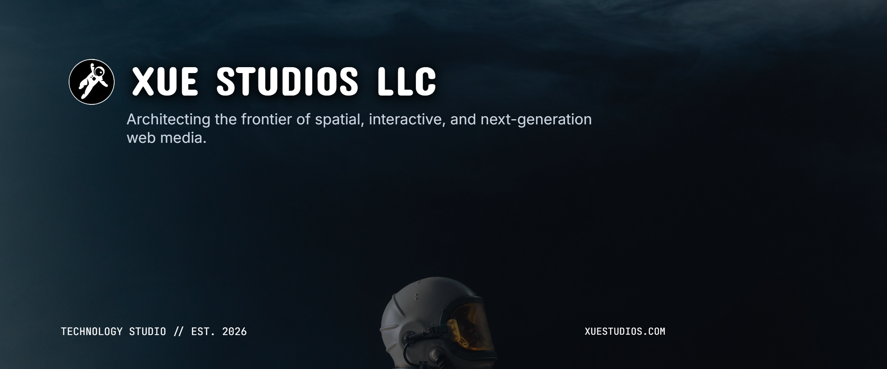
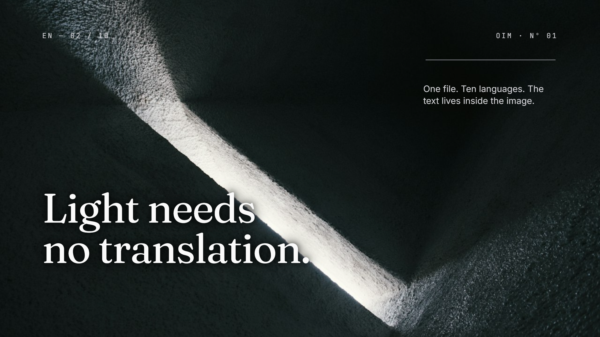

  

# Xue Studios LLC

Xue Studios LLC is an engineering and creative technology studio dedicated to spatial computing, interactive runtimes, and open web standards.

---

## Object Interactive Media (OIM)

Object Interactive Media is an open container format that bridges visual raster media and the interactive web. It embeds multilingual, accessible, and kinetic DOM layers directly inside standard PNG files, enabling universal visual parity across platforms while unlocking real-time interaction in modern web runtimes.

  

- **Platform:** [oim.media](https://oim.media)
- **Authoring Studio:** [studio.oim.media](https://studio.oim.media)
- **Core Decoders:** `@oim/core`
- **Web Component:** `@oim/player-oim`

---

## Contact

- **Website:** [xuestudios.com](https://xuestudios.com)
- **General Inquiries:** [contact@xuestudios.com](mailto:contact@xuestudios.com)
- **Platform Support:** [support@oim.media](mailto:support@oim.media)
