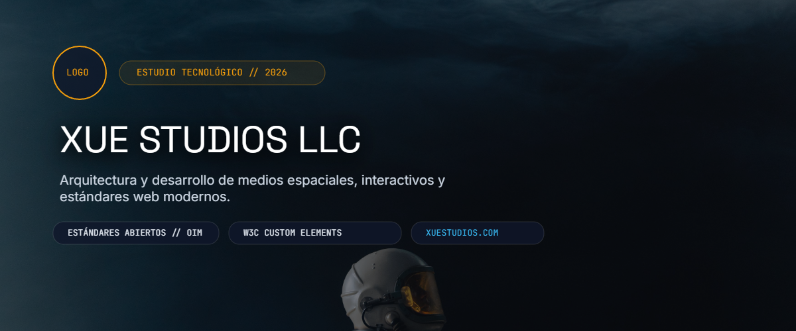

<p align="center">
  
</p>

# Xue Studios LLC

Xue Studios LLC designs, engineers, and builds high-performance software systems, interactive spatial media formats, and next-generation web runtimes.

We are the creators and maintainers of **Object Interactive Media (OIM)**, an open container standard that decouples visual media from interactive, multilingual, and animated DOM layers.

---

## Object Interactive Media (OIM Standard)

Digital media has historically faced a rigid dichotomy: static raster images (PNG, JPEG, WebP) are universally portable but lack interactivity, accessibility, and localization; whereas interactive web applications require complex bundles, external stylesheets, and custom hosting.

The **OIM Standard** bridges this divide by embedding interactive DOM metadata directly inside standard PNG files:

1. **Universal Portability (Dual-State Degradation):** In standard operating environments such as GitHub, email clients, social platforms, and desktop operating systems, an `.oim.png` file renders natively as a standard 32-bit PNG image with zero compatibility errors.
2. **Dynamic Runtime Activation:** In web runtimes, documentation frameworks, and modern blogs, the zero-dependency `<oim-player>` Custom Element parses the embedded metadata, promoting the image into an interactive, multilingual DOM surface with zero network latency.
3. **Cryptographic Provenance:** Every production `.oim` artifact carries an ECDSA P-256 digital signature embedded within an RFC-compliant PNG chunk (`tEXt` / `zTXt`), validating author authenticity and preventing client-side tampering.

<p align="center">
  <a href="https://oim.media" target="_blank" rel="noopener noreferrer">
    
  </a>
  <br />
  <sub><b>Figure 1.0:</b> Canonical multilingual hero specimen (<code>hero-multilingual.oim.png</code>). Encapsulates 7 languages (ES, EN, PT, FR, DE, IT, JA) and 19 interactive slots with zero-bandwidth runtime DOM switching. Select image to open live in player.</sub>
</p>

---

## Markdown & Document Integration Standard

In content platforms, editorial engines, and technical documentation, OIM enables direct declarative embedding within Markdown pipelines.

### Active Web Runtime (Blog, VitePress, Astro, Next.js)

When loaded in web environments supporting Custom Elements, Markdown parsers render the interactive component natively:

```html
<!-- Declarative embed with automated aspect ratio preservation -->
<oim-player 
  src="https://oim.media/flyer_audifonos.oim.png" 
  ratio="16/9"
  lang="en">
</oim-player>
```

### Static Markdown Fallback (GitHub, GitLab, Readmes)

In environments where client-side JavaScript execution is restricted by security sanitizers, OIM leverages standard image syntax with a direct hyperlink to the live viewer:

```markdown
[](https://oim.media)
```

This guarantees 100% visual uptime across every distribution channel while retaining instant access to interactive functionality.

---

## Binary Verification & Dynamic Data Integrity

Every `.oim.png` artifact is verified against RFC-2083 PNG specifications and the OIM binary schema:

```
Payload Analysis: hero-multilingual.oim.png
Chunk Identifier: zTXt (Keyword: OIM_Data, Compression: Deflate)
Decompressed Size: 370,636 bytes (Valid JSON)
Languages Declared: ["es", "en", "pt", "fr", "de", "it", "ja"]
Interactive Slots: 19 structured vector & text slots
Security Status: ECDSA P-256 signature chain validated
```

---

## Technology Stack & Module Matrix

| Package / Module | Scope | Architecture & Capabilities | License |
| :--- | :--- | :--- | :--- |
| **`@oim/core`** | Binary Specification | PNG `tEXt` / `zTXt` demuxer, Deflate extraction, Zod runtime validation, dynamic coordinate projection (`cqw`), and ECDSA verification. | Apache-2.0 |
| **`@oim/player-oim`** | Web Component | Zero-dependency W3C Custom Element (`<oim-player>`). Instant DOM hydration, sub-millisecond language switching, and kinetic typography. | Apache-2.0 |
| **`@oim/player-ovm`** | Video Runtime | Spatial-temporal interactive video engine with hot-spot branching and synchronized state actions. | Apache-2.0 |
| **`OIM Studio`** | Authoring Suite | Multi-layer visual design studio with vector engines, parallax choreography, generative backgrounds, and asset packaging. | Proprietary |
| **`OVM Studio`** | Interactive Timeline | Non-linear video editor with WebGL transition pipelines and dynamic layer anchoring. | Proprietary |

---

## Engineering Roadmap & Status

### Phase: Private Beta & Active Hardening

Engineering repositories across the Xue Studios LLC ecosystem are undergoing rigorous fuzz testing, conformance vector validation, and security auditing.

- **Conformance Vectors:** Core validation against RFC-2083 PNG specifications and binary metadata contracts.
- **Supply Chain Security:** Strict policy enforcement with automated script sandboxing, dependency auditing, and signed release commits.
- **Public Packaging:** Open-source runtime libraries will be distributed to npm upon completion of initial release audits.

---

## Licensing Philosophy

Xue Studios LLC maintains a balanced open-core model:

- **Open Specifications & Runtimes:** The core binary formats, decoding engines, and embeddable player components are released under the **Apache-2.0** license to foster global web interoperability.
- **Commercial Tooling & Infrastructure:** Cloud packaging backends, collaborative visual studios, and enterprise verification systems are developed and maintained as proprietary technology by Xue Studios LLC.

---

## Contact & Inquiries

- **Official Platform:** [oim.media](https://oim.media)
- **Corporate Portal:** [xuestudios.com](https://xuestudios.com)
- **Technical Inquiries:** [contact@xuestudios.com](mailto:contact@xuestudios.com)
- **Security Disclosures:** [support@oim.media](mailto:support@oim.media)
